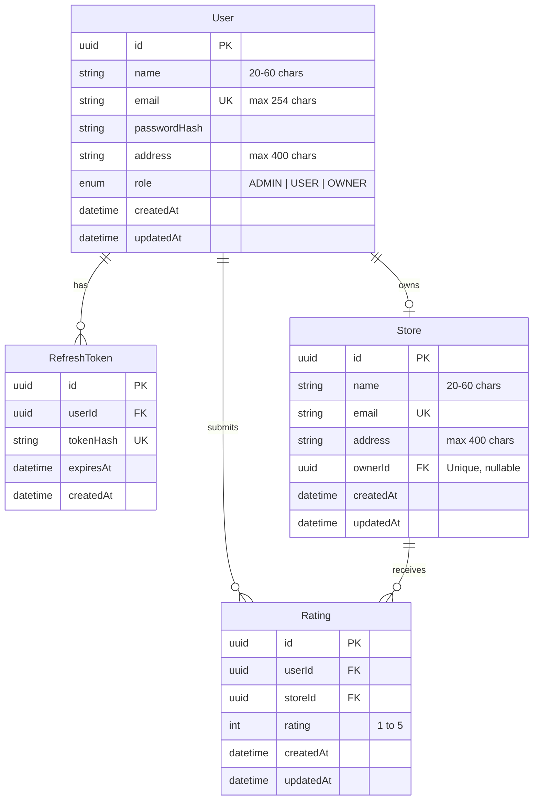

# Store Rating Platform

A full-stack, production-grade web application where users rate registered stores on a scale of 1 to 5. Features role-based access control (System Administrator, Normal User, Store Owner), strict validation on both client and server, and a high-density, professional UI that utilizes the full browser viewport without synthetic empty cards.

---

## 1. Demo Credentials

All test accounts use the common demo password meeting the strict validation rules (8–16 characters, at least one uppercase letter, at least one special character):

| Role | Email | Password | Assigned Store / Access |
| --- | --- | --- | --- |
| **System Administrator** | `admin@storerating.com` | `Admin@1234` | Full access to users, stores & platform metrics |
| **Store Owner** | `marcus.owner@example.com` | `Admin@1234` | The Daily Grind Coffeehouse (ratings table & metrics) |
| **Store Owner** | `priya.owner@example.com` | `Admin@1234` | Sharma Electronics Center |
| **Store Owner** | `olivia.owner@example.com` | `Admin@1234` | *(No store assigned — empty state demo)* |
| **Normal User** | `user1@example.com` | `Admin@1234` | Store exploration & live 1–5 star rating |
| **Normal User** | `user2@example.com` | `Admin@1234` | Store exploration & live 1–5 star rating |

---

## 2. Architecture & Tech Stack

| Layer | Technology | Details |
| --- | --- | --- |
| **Backend** | Node.js 20 LTS, Express.js, TypeScript | Clean modular domain architecture (`/modules/auth`, `admin`, `stores`, `owner`) |
| **Database** | PostgreSQL 15+ | Relational schema with foreign keys, compound indexes, unique rating constraints |
| **ORM** | Prisma ORM | Type-safe queries, aggregations, parameterized raw queries for sorting nulls |
| **Frontend** | React 19, Vite, TypeScript | Modern UI with Tailwind CSS v4, Lucide icons, full viewport utilization |
| **State & Data** | TanStack Query v5 | Optimistic UI rating updates, caching, automatic invalidation |
| **Forms** | React Hook Form + Zod | Schema-driven validation with live checklist requirements |
| **Auth & Security** | JWT (HttpOnly cookies) + Argon2id | Rotating refresh tokens, CSRF protection, rate limiting, Helmet, CSP |
| **Testing** | Vitest + Supertest | Schema validation unit tests, API security & auth integration tests |

---

## 3. Schema Diagram



---

## 4. Quick Start (Run in under 5 minutes)

### Prerequisites
- Node.js 20 LTS+
- Docker & Docker Compose (or local PostgreSQL instance)

### Step 1: Start PostgreSQL
```bash
docker compose up -d
```

### Step 2: Configure Environment Variables
Copy `.env.example` in both root and server:
```bash
cp .env.example .env
cp .env.example server/.env
```

### Step 3: Setup Server
```bash
cd server
npm install
npx prisma migrate dev --name init
npm run db:seed
npm run build
```

### Step 4: Setup Client
```bash
cd ../client
npm install
npm run build
```

### Step 5: Run Development Servers
In terminal 1 (Server):
```bash
cd server
npm run dev
# Server running at http://localhost:3000
```

In terminal 2 (Client):
```bash
cd client
npm run dev
# Frontend running at http://localhost:5173
```

---

## 5. Running Tests

Run the backend unit and security integration test suite:
```bash
cd server
npm test
```

Run frontend linter and build check:
```bash
cd client
npm run lint
npm run build
```

---

## 6. API Summary

### Authentication (`/api/auth`)
- `POST /api/auth/signup` — Public registration for Normal Users.
- `POST /api/auth/login` — Single login endpoint for all roles.
- `POST /api/auth/refresh` — Silent rotating refresh token endpoint.
- `POST /api/auth/logout` — Revokes session & clears HttpOnly cookies.
- `GET /api/auth/me` — Fetches current authenticated session & user details.
- `PATCH /api/auth/password` — Authenticated password change with current password check.

### Admin Portal (`/api/admin`) *(Requires ADMIN role)*
- `GET /api/admin/dashboard` — Platform totals (users, stores, ratings).
- `GET /api/admin/users` — Filterable (name, email, address, role), sortable & paginated users list.
- `POST /api/admin/users` — Creates any role (Admin, Normal User, Store Owner).
- `GET /api/admin/users/:id` — User profile details with store rating summary for owners.
- `GET /api/admin/stores` — Filterable, sortable & paginated stores list.
- `POST /api/admin/stores` — Creates a store and assigns an available owner.
- `GET /api/admin/owners/available` — Returns unassigned Store Owners.

### Normal User Portal (`/api/stores`) *(Requires USER role)*
- `GET /api/stores` — Search stores by name and address (300ms debounced), sorted by name or rating, with user's personal rating.
- `PUT /api/stores/:storeId/rating` — Submits or modifies rating (1 to 5) with optimistic cache updates.

### Store Owner Portal (`/api/owner`) *(Requires OWNER role)*
- `GET /api/owner/dashboard` — Assigned store metrics (average rating & total count).
- `GET /api/owner/ratings` — Paginated & sortable list of raters (name, email, rating, date).

---

## 7. Security Measures Implemented

1. **Password Hashing:** Passwords hashed with `argon2id` (memoryCost: 19456, timeCost: 2, parallelism: 1).
2. **HttpOnly Cookies:** Access and refresh tokens stored strictly in `HttpOnly`, `SameSite=Lax`, secure-ready cookies. No tokens in `localStorage` or `sessionStorage`.
3. **Rotating Refresh Tokens & Reuse Detection:** Single-use refresh tokens stored as SHA-256 hashes in database.
4. **CSRF Protection:** State-changing requests (`POST`, `PUT`, `PATCH`, `DELETE`) require the `X-Requested-With: fetch` custom header.
5. **Rate Limiting:** Global rate limiting (100 req/min) and auth limiter (10 req/15min) using `express-rate-limit`.
6. **Input Validation:** Zod schemas applied on both client and server with `strict()` mode to block mass assignment.
7. **SQL Injection Defense:** All queries executed via Prisma ORM or parameterized raw queries (`$1`, `$2`). All `LIKE` wildcards (`%`, `_`, `\`) properly escaped.
8. **Security Headers:** Helmet enabled with strict Content Security Policy (CSP) and `x-powered-by` disabled.

---

## 8. Assumptions

- **A1:** Store Name uses the same 20 to 60 character rule as user Name.
- **A2:** Store Owners are created by administrators, and can own at most one store.
- **A3:** Overall Rating is the arithmetic mean of all submitted ratings, displayed with 1 decimal place and count (e.g. `4.2 (18)`).
- **A4:** Administrators and Store Owners cannot submit ratings; only Normal Users rate stores.
- **A5:** Deletion of users, stores, or ratings is out of scope per PRD non-goals.
- **A6:** Public signup redirects to `/login?registered=1` with an inline success banner.
